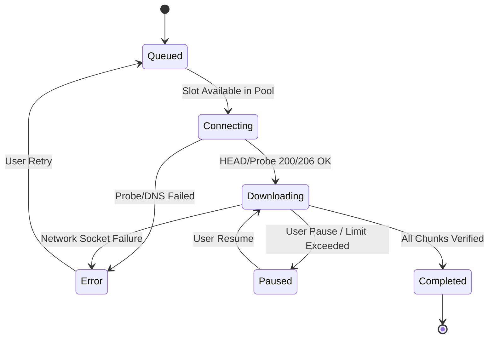

# DLX Download Manager Architecture Guide

This document describes the architectural layout, threading model, and subsystem communication within the DLX Download Manager.

```
+-------------------------------------------------------------------------------+
|                             Chrome / Edge Extension                           |
|  - Content Script (DOM sniffing, blob interception)                           |
|  - Background Service Worker (Native Messaging Host bridge)                   |
+---------------------------------------+---------------------------------------+
                                        | Native Messaging IPC (JSON-RPC)
+---------------------------------------v---------------------------------------+
|                       DLX Core Application (Electron)                        |
|                                                                               |
|  +----------------------------+             +-------------------------------+  |
|  |     Main Process (Node.js) |             |     Renderer Process (React)  |  |
|  |                            |   IPC Bus   |                               |  |
|  | - Engine Orchestrator      |<----------->| - Zustand Reactive Store      |  |
|  | - Range Chunk Worker Pool  |             | - Speedometer & Graph Visuals |  |
|  | - ISO BMFF / fMP4 Muxer    |             | - Category Filters & Search   |  |
|  | - Torrent WebTorrent Engine|             | - Settings & Configuration UI |  |
|  +----------------------------+             +-------------------------------+  |
+-------------------------------------------------------------------------------+
```

---

## 1. Process Separation & Security Model

DLX follows Electron's multi-process security guidelines:

1. **Main Process (`src/main/`)**:
   - Executes in privileged Node.js environment.
   - Manages OS-level file handles, network sockets, system tray, window lifecycles, and native notifications.
   - Owns the `DownloadEngine` state machine, task queues, and storage persistence.

2. **Preload Context Bridge (`src/preload/index.ts`)**:
   - Runs in an isolated execution context with `contextIsolation: true`.
   - Exposes a strongly-typed `window.dlx` API via `electron.contextBridge`.
   - Prevents arbitrary code execution in the renderer while allowing event streams and command dispatches.

3. **Renderer Process (`src/renderer/`)**:
   - Built with React 18, Vite, and Tailwind CSS.
   - Strictly decoupled from direct disk or socket access.
   - Receives batched tick events (100ms intervals) to render real-time download speeds, progress percentages, and chunk diagrams without UI stutter.

---

## 2. Multi-Threaded Chunking Engine

The core HTTP/HTTPS downloading engine utilizes concurrent HTTP Range requests:

- **Initial Head & Range Probing**:
  When a URL is submitted, `inspector.ts` issues probe requests to inspect `Accept-Ranges`, `Content-Length`, `Content-Disposition`, and `Content-Type`.
- **Dynamic Chunk Allocation**:
  If the remote server supports byte-range requests (`Accept-Ranges: bytes`), the file is divided into `N` concurrent chunks (default: 8, configurable up to 32).
- **Persistent HTTP Agent**:
  Connections utilize keep-alive connection pooling (`keepAliveHttpAgent` and `keepAliveHttpsAgent`) with pre-warmed TCP sockets and socket reuse to eliminate TLS handshake latency on successive chunks.
- **In-Place Segment Merging**:
  Chunks write directly to their deterministic byte offsets using non-blocking file descriptors (`fs.open` with `r+` or position offsets), avoiding expensive post-download memory concatenation.

### Task Lifecycle State Machine



---


## 3. High-Definition ISO BMFF & Adaptive Media Transmuxing

Modern streaming services (including YouTube 1080p+ and HLS/DASH media) separate video and audio tracks:

1. **Stream Detection**:
   Inspects stream payloads and extracts matching adaptive video and audio tracks.
2. **Synchronous Chunk Downloading**:
   Downloads the pristine 1080p video stream and corresponding high-fidelity audio stream simultaneously.
3. **In-Engine ISO BMFF Muxing**:
   The native ISO MP4 multiplexer parses box structures (`ftyp`, `moov`, `trak`, `mdia`, `minf`, `stbl`, `mdat`) and interleaves audio and video samples into standard ISO/IEC 14496-14 `.mp4` containers playable on any device without requiring heavyweight external FFmpeg binaries.

---

## 4. BitTorrent Swarm Engine

The BitTorrent subsystem is powered by WebTorrent:

- Fast metadata resolution from magnet links (`xt=urn:btih:...`) via DHT and public trackers.
- Pre-allocated sparse files with sequential piece streaming support.
- Configurable upload/download throttles with swarm-level peer management.
- Torrent piece map emitted to the UI for interactive visualization.

---

## 5. Browser Extension Integration

The browser extension communicates with DLX via the Chrome Native Messaging protocol:

- Extension registers native messaging host `com.dlx.downloadmanager`.
- Background worker listens for `chrome.downloads.onCreated` and custom webRequest video/audio mime sniffers.
- Messages are serialized as standard 32-bit length-prefixed JSON payloads over standard input/output (`stdin`/`stdout`).
- Seamless one-click interception captures video streams directly from web pages with user-selected quality presets.
